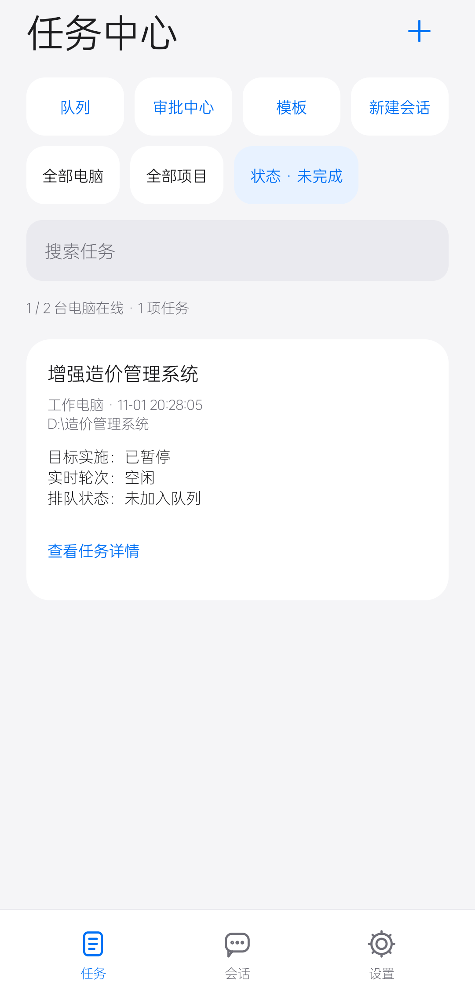
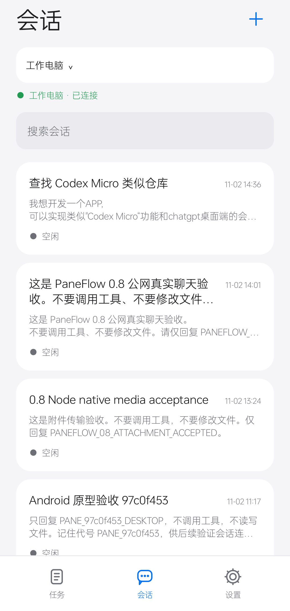

# PaneFlow · Codex随行

Windows + Android 的 Codex 任务与会话配套端。基于 [Codex Pane](https://github.com/jadchene/codex-pane) 扩展，保留上游 MIT 许可。

手机原生应用 **Codex随行 0.8.0**，启动品牌 **PaneFlow**，Windows 配套端 **PaneFlow Desktop 0.8.0**。

> 任务随行，随时继续。

**最新通用 APK（2026-11-03）**：[手机／平板下载](https://github.com/kismet84/paneflow/releases/download/v0.8.0/PaneFlow-Android-0.8.0-universal-20261103.apk) · [SHA256](https://github.com/kismet84/paneflow/releases/download/v0.8.0/SHA256SUMS-universal-20261103.txt)。包含平板 UI、任务目标完成提醒及此前 Android 增量。同一个 APK 自动适配手机和平板；版本仍为 0.8.0 / 10，与原发布包同为 debug 签名原型，可手动覆盖安装保留绑定。此补充包不改动原 v0.8.0 标签、Windows 安装包或旧 update.json；应用内更新清单暂不指向此包。

新设备安装、固定隧道配置向导、扫码和升级恢复步骤见 [安装与升级指南](docs/INSTALL-UPGRADE.md)。

0.8 新增原生富文本、历史折叠、图片与文件附件、系统语音转文字。见 [使用说明](docs/CHAT-MEDIA.md) 与 [验证报告](docs/VALIDATION-0.8.md) 与 [公网升级验收](docs/VALIDATION-0.8-PUBLIC.md)。

## 功能

- 原生 Android 全屏任务、会话、聊天和设置界面；手机和平板共用 APK。宽窗口启用左侧导航＋会话侧栏＋限宽聊天，窄窗口保留手机布局；浏览器保留作备用入口。
- 查看任务目标状态、继续真实会话、停止当前轮次、审批、分叉、模型与推理强度切换。
- 会话首批 5 条，下滑按服务端游标追加 10 条。
- 设备密钥配对、桌面身份校验、端到端加密；重连不自动重发未确认消息。
- 固定 Cloudflare Named Tunnel 公网入口；Windows 登录自启、托盘后台及服务故障恢复。
- Android 后台连接与通知、网络恢复重连；系统 DNS 失败时使用 HTTPS DNS 备用解析。

## 手机实机截图

以下页面在 OPPO K10 上渲染：统一标题、页面边距、搜索框和卡片排版。截图不含手机状态栏；会话列表使用虚构电脑名称、会话标题和预览内容，不展示真实聊天记录。连接状态和记录数量仅作界面演示。

| 任务中心 | 会话列表 |
|---|---|
|  |  |

本次界面调整与真机检查见 [视觉对齐记录](docs/UI-ALIGNMENT-0.8.md)。

## 平板布局

窗口宽度达到 840dp 时切换为桌面式布局：72dp 导航栏、320dp 会话侧栏，聊天内容最大 840dp；任务与设置页最大 960dp，操作弹窗居中。横竖屏按当前窗口宽度适配。MatePad Pro 已验证真实聊天、只读同步、电脑选择返回与旋转恢复，见 [平板 UI 验证](docs/VALIDATION-TABLET-UI.md)。本次平板截图包含真实聊天，仅保留本地，不发布到公开仓库。

## 手机／平板使用说明

### 1. 安装与连接电脑

0.5 支持多台电脑：在 **设置 → 我的电脑 → 添加电脑** 分别配对，可命名、切换、移除。每台电脑保持独立固定入口和身份；旧单电脑绑定原地保留。给另一台电脑配对请用“添加电脑”，已有配置的“重新配对”只接受原电脑身份。

前台连接全部已配置电脑；后台只连接逐台明确开启后台连接的电脑，新电脑默认关闭。每台电脑的选中会话、草稿、操作记录和阅读位置分别保存，手机选择不会改变电脑窗口或另一客户端的选择。

1. 按下方构建步骤生成 Android APK，并在手机上安装。可从 [0.8.0 Release](https://github.com/kismet84/paneflow/releases/tag/v0.8.0) 下载文件名含 `universal-20261103` 的最新通用 APK；最低 Android 8.0（API 26）。升级时使用同一签名覆盖安装，保留应用数据。
2. 在 Windows 上完成 Codex 登录、工作目录和[固定公网部署](docs/PUBLIC_DEPLOYMENT.md)，启动 PaneFlow Desktop。任务实际在这台电脑执行。
3. 电脑打开 **设置 → 远程访问**，生成配对链接。手机打开 **Codex随行 → 粘贴配对链接**，输入完整链接后点 **继续**。
4. 核对手机与电脑显示的六位数字，**仅在一致时于电脑确认**。首次绑定完成后，手机使用设备密钥自动认证，无需 Chrome 或 Passkey。

公网连接可跨网络使用；电脑需要保持联网、运行且未休眠。USB 仅用于开发调试和安装，不是固定公网连接的必要条件。

### 2. 查看任务与继续会话

| 入口 | 操作与行为 |
|---|---|
| **任务** | 聚合已连接电脑，按电脑、项目、状态筛选；分别显示目标实施、实时轮次、排队状态。详情可进入关联聊天。 |
| **会话** | 连接成功后刷新最近 5 条；平时切页复用缓存，连续双击“会话”导航刷新（手机底部、平板左侧）。向下滚动继续加载，每次追加 10 条。点击记录查看历史、输入消息继续；搜索会重新开始分页。 |
| **新建会话（＋）** | 可填写 Windows 工作目录、选择模型和推理强度、输入首条消息，再点“开始会话”；目录留空时使用电脑默认目录。 |
| **聊天** | 阅读回复与工具结果，在底部输入并发送消息。正文支持基础 Markdown 与代码块复制。 |

### 3. 控制任务

- **任务队列**：任务页选择“队列”或右上角“＋”，填写目标电脑的工作目录、提示词及可选模型。每台电脑默认一个执行槽，按先后执行；等待审批时不派发下一项。可暂停/继续派发、取消待执行项或停止当前项。
- **结果待核对**：重启或断线后无法确认执行结果时，队列暂停。先查看关联聊天，再明确登记已完成、失败或取消；之后手动继续。应用不会自动重放未知任务。
- **审批中心**：集中查看各电脑的待审批项，逐项核对电脑、会话、目录和操作；其他设备已处理或版本变化时旧弹层失效。
- **模板**：从添加排队任务页保存模板，按电脑加密保存目录、提示词、模型和强度；不保存永久审批许可。
- **停止**：聊天页打开“会话操作 → 停止当前任务”，核对后确认。停止不会撤销已经完成的文件修改。
- **审批**：打开待确认项，核对操作内容后选择“仅同意本次”或“拒绝”；部分 MCP 请求会显示具体选项。手机不会因此授予永久权限；未支持的复杂审批需到电脑处理。
- **分叉**：当前会话空闲后，选择“会话操作 → 分叉当前会话”，填写名称并创建；新会话保留历史，原会话不变。
- **模型与强度**：点击聊天顶部模型行，或进入“会话操作 → 模型与推理强度”。选择服务端支持的配置并应用，当前会话下一轮生效；运行中的轮次结束后才能修改。

### 4. 后台提醒与断线恢复

1. 手机进入 **设置 → 后台与通知**，开启“后台保持连接”，确认说明并允许系统通知。
2. 可分别开启“任务目标完成”和“待审批提醒”；后台服务会显示持续通知。只有已观察到的任务目标从未完成变为 `complete` 才发完成通知；单轮回复结束、进入空闲和队列单轮完成均不触发。首次看到历史已完成任务不补发，重复快照及 APP 重启去重；无可靠目标状态的普通会话不推测完成。应用前台不发系统完成通知。通知不包含会话正文、标题或命令。

   MatePad Pro 真实两阶段验收：第一小轮无通知，整个目标完成约 8.2 秒后收到通知，点击返回对应聊天；详见 [完成提醒验证](docs/VALIDATION-TASK-COMPLETION.md)。
3. 网络中断后自动重连。若消息发送结果未确认，先检查历史，再决定是否重发；APP 不会自动补发，避免重复执行。
4. 如果同一台电脑的入口需要迁移，进入 **设置 → 连接管理 → 连接地址**，填写新的固定 HTTPS 地址并保存。原设备绑定与电脑密钥保留；新地址仍需通过原电脑身份校验。
5. Windows 登录自启配置好后，关闭桌面窗口会留在托盘；托盘“退出并停止手机连接”会停止本次服务。

后台使用 Android 前台服务，尚无 FCM／厂商推送。手机被强制停止、系统清理或深度省电时，提醒可能中断；重新打开 APP 可恢复连接。需要检查权限时，使用“后台与通知”里的系统通知／电池设置入口。

### 5. 配对与连接问题

**设置 → 连接管理 → 连接诊断** 分层显示入口、解析、中继、电脑和认证状态，并可导出脱敏诊断。聊天中的“发送记录”区分等待回执、已接受、结果待核对和失败；重连只查询结果，不自动重发。遇到“待核对”，先打开关联会话检查。草稿和操作记录使用 Android Keystore 加密保存。

聊天顶部可向上加载更早消息，返回会话恢复阅读位置。电脑未声明新能力时，手机提示升级，不把旧协议的全局选择冒充独立会话。其他进程正在写入的 Codex 会话可能拒绝接管，应等待原进程释放；不同电脑的 Codex 数据仍各自保存。

| 情况 | 处理方法 |
|---|---|
| 电脑离线或一直重连 | 检查电脑联网、未休眠，确认配套端、中继和隧道运行；可在手机“连接管理”点“立即重连”。 |
| 旧临时地址失效 | 为同一台电脑配置固定域名，再通过“连接地址”迁移，不要先移除绑定。 |
| 配对码不一致或链接过期 | 取消配对，在电脑重新生成链接；不要确认不一致的数字。 |
| 显示身份不匹配／设备被撤销 | 检查是否连接了正确电脑，必要时在电脑重新发起配对；不能靠普通重试绕过身份校验。 |
| 更换电脑 | 使用“设置 → 配对其他电脑”；每台电脑独立保存入口与设备绑定。 |
| 不再使用这台电脑 | “设置 → 移除本机绑定”只移除手机绑定，不删除电脑文件或会话；要撤销该设备的访问权，还需在电脑远程访问设置撤销手机。 |

## 更新记录

完整记录见 [CHANGELOG](CHANGELOG.md)。

| 版本／更新 | 日期 | 主要变化 |
|---|---|---|
| **0.8.0 通用 APK 增量** | 2026-11-03 | 平板自适应 UI、目标完成提醒与持久去重；包含会话缓存、只读同步、账户额度和此前界面改进。Windows 包仍为原 0.8.0 资产，电脑端后续源码增量未重打包。 |
| **0.8.0** | 2026-11-02 | 原生富文本、历史折叠、图片/文件附件、系统语音输入；任务与会话页视觉对齐，README 更新 OPPO 实机截图；[验证报告](docs/VALIDATION-0.8.md)。 |
| **0.7.0** | 2026-11-02 | Windows 配置向导与安装包、扫码输入、明确确认的升级与恢复、CI 和受控签名发布流程；[验证报告](docs/VALIDATION-0.7.md)。 |
| **0.6.0** | 2026-11-02 | 多电脑任务中心、加密持久队列、审批中心、任务详情和模板；[验证报告](docs/VALIDATION-0.6.md)。 |
| **0.5.0** | 2026-11-02 | 多电脑绑定、独立会话、可靠回执、加密草稿与历史分页；[验证报告](docs/VALIDATION-0.5.md)。 |
| 文档更新 | 2026-11-02 | README 加入 16 个页面／状态的 UI 草图、手机操作指南和版本记录。 |
| **0.4.1** | 2026-11-02 | 固定公网入口、Windows 登录自启与托盘、服务故障恢复、手机自动重连、保留绑定迁移地址、HTTPS DNS 备用解析。 |
| **0.4.0** | 2026-11-02 | Codex随行 / PaneFlow 品牌统一、跨窗口目标状态、会话 5/10 分页、紧凑模型选择和视觉对齐。 |
| **0.3.0** | 2026-11-02 | 原生全屏任务／会话／设置与聊天界面，操作弹层、草稿恢复和通知分类开关。 |

## 构建

要求 Windows、Node.js 22+、npm、Codex CLI、PowerShell 7；Android 构建还需 JDK 21、Android SDK 36。先完成 Codex 登录或模型提供方配置。

```powershell
npm ci
npm --prefix remote/mobile ci
npm --prefix remote/relay ci
npm --prefix companion ci
npm run build
npm --prefix remote/relay run build
npm run package:win
npm --prefix companion run apk
```

Android SDK 路径写入本地 `companion/android/local.properties`，或使用 `ANDROID_HOME`。不要提交本地配置。产物为 `release/win-unpacked/PaneFlow Desktop.exe` 与 `companion/android/app/build/outputs/apk/debug/app-debug.apk`。APK 使用本机调试签名；Git 仓库不包含发布私钥或预构建安装包。安装包与 SHA256 校验文件见 [0.8.0 Release](https://github.com/kismet84/paneflow/releases/tag/v0.8.0)。本次 Android 包沿用已验证的 debug 签名原型，支持相同签名覆盖安装；Windows 安装包未作 Authenticode 签名。

## 固定公网与自启

按 [部署说明](docs/PUBLIC_DEPLOYMENT.md) 创建自己的域名、独立 Cloudflare Tunnel 和本地配置，再运行 `启动公网原型.cmd`。首次配对须核对电脑与手机上的六位数字。之后保持配置与设备身份数据，重启无需重新配对。

不要直接使用别人的域名或部署凭据；本仓库只提供模板，不包含运行中的服务地址、用户数据、聊天记录或设备绑定。

## 测试

```powershell
npm test
npm --prefix remote/relay test
npm --prefix companion test
node --test scripts/test-public-restart.mjs
```

`test-public-restart.mjs` 需要先构建 relay。Android 真机测试位于 `companion/android/app/src/androidTest`，需要自己的已配对设备；详细范围见 [验证说明](companion/VALIDATION.md)。

## 当前边界

- 当前为原型版本。桌面目标状态可跨窗口读取，实时轮次与控制来自配套端连接的 app-server；不等于控制所有 Codex 进程。
- 任务目录为最近 100 个会话。重新连接后会话列表回到首批 5 条。
- 自启发生在当前 Windows 用户登录后。电脑关机、休眠或手机被强制停止时，不保证后台连接和通知。
- 后台通知使用 Android 前台服务，未接入 FCM／厂商推送。
- 独立会话选择需要电脑支持对应协议能力；旧版电脑需升级。

## 来源与许可

上游基线：`jadchene/codex-pane`，提交 `13b9308`。本仓库以独立初始提交发布最新代码快照，未携带本机开发历史。上游说明见 [英文](README.upstream.md) / [中文](README.upstream.zh-CN.md)。版权声明与 [MIT LICENSE](LICENSE) 保留。
