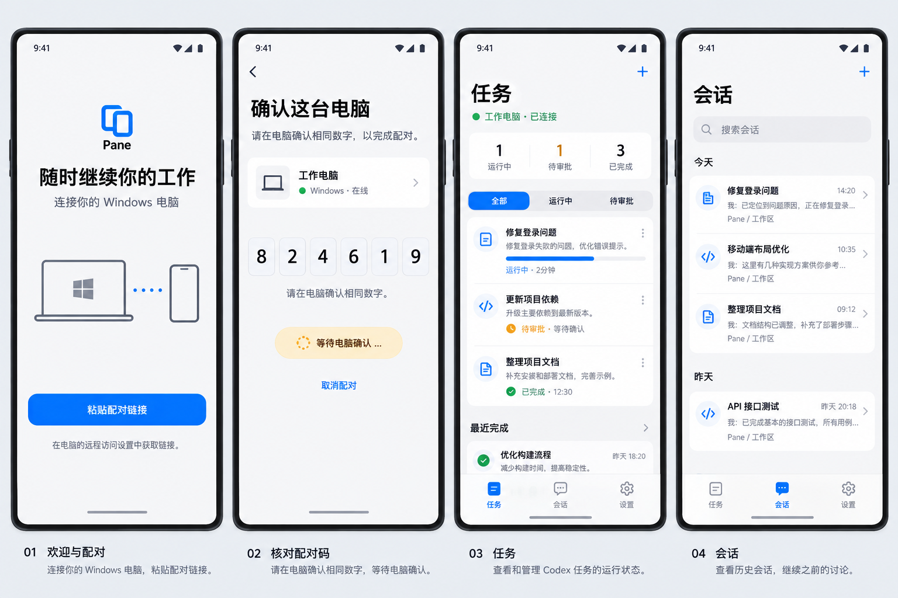
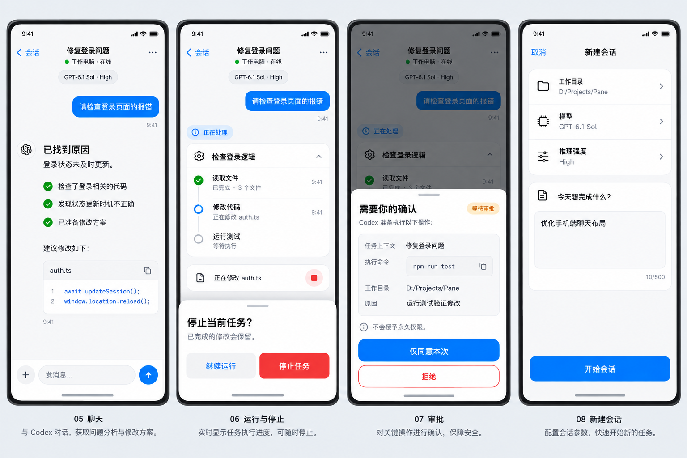
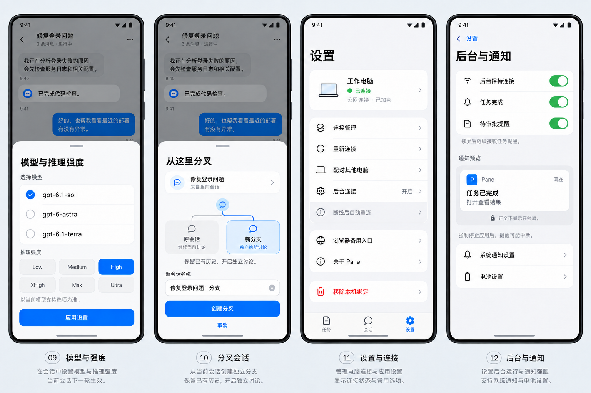
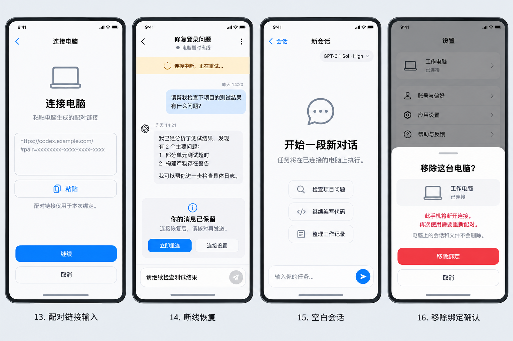

# PaneFlow · Codex随行

Windows + Android 的 Codex 任务与会话配套端。基于 [Codex Pane](https://github.com/jadchene/codex-pane) 扩展，保留上游 MIT 许可。

手机原生应用 **Codex随行 0.4.1**，启动品牌 **PaneFlow**，Windows 配套端 **PaneFlow Desktop**。

> 任务随行，随时继续。

## 功能

- 原生 Android 全屏任务、会话、聊天和设置界面；浏览器界面保留作备用入口。
- 查看任务目标状态、继续真实会话、停止当前轮次、审批、分叉、模型与推理强度切换。
- 会话首批 5 条，下滑按服务端游标追加 10 条。
- 设备密钥配对、桌面身份校验、端到端加密；重连不自动重发未确认消息。
- 固定 Cloudflare Named Tunnel 公网入口；Windows 登录自启、托盘后台及服务故障恢复。
- Android 后台连接与通知、网络恢复重连；系统 DNS 失败时使用 HTTPS DNS 备用解析。

## UI 草图

以下是已采用的早期设计草图，共 **4 张图板、16 个页面／状态**，展示浅色全屏布局、底部导航与操作弹层。图中任务、配对码、路径和对话均为示例，不是真实用户数据。

草图保留了早期 **Pane** 名称；当前版本名称为 **Codex随行 / PaneFlow**。模型、推理强度及任务状态以实际服务返回为准。图中部分示意与当前实现不同：模型调整和分叉须等当前轮次结束，分叉从当前会话创建，不支持任意历史消息分叉。

### 连接与导航

欢迎与配对 → 核对配对码 → 任务 → 会话。



### 聊天与操作

原生聊天、运行与停止、审批、新建会话。



### 配置与通知

模型与推理强度、分叉会话、设置与连接、后台与通知。



### 关键状态

配对链接输入、断线恢复、空白会话、移除绑定确认。



## 手机端使用说明

### 1. 安装与连接电脑

1. 按下方构建步骤生成 Android APK，并在手机上安装。当前仓库只发布源码，没有预构建 APK 下载；最低 Android 8.0（API 26）。升级时使用同一签名覆盖安装，保留应用数据。
2. 在 Windows 上完成 Codex 登录、工作目录和[固定公网部署](docs/PUBLIC_DEPLOYMENT.md)，启动 PaneFlow Desktop。任务实际在这台电脑执行。
3. 电脑打开 **设置 → 远程访问**，生成配对链接。手机打开 **Codex随行 → 粘贴配对链接**，输入完整链接后点 **继续**。
4. 核对手机与电脑显示的六位数字，**仅在一致时于电脑确认**。首次绑定完成后，手机使用设备密钥自动认证，无需 Chrome 或 Passkey。

公网连接可跨网络使用；电脑需要保持联网、运行且未休眠。USB 仅用于开发调试和安装，不是固定公网连接的必要条件。

### 2. 查看任务与继续会话

| 入口 | 操作与行为 |
|---|---|
| **任务** | 查看未完成、实施中、暂停、待处理等状态，搜索并进入目标会话。持久目标状态与本连接的执行中轮次分别统计，暂停不等于执行中。 |
| **会话** | 默认加载最近 5 条记录；向下滚动继续加载，每次追加 10 条。点击记录查看历史、输入消息继续；搜索会重新开始分页。 |
| **新建会话（＋）** | 可填写 Windows 工作目录、选择模型和推理强度、输入首条消息，再点“开始会话”；目录留空时使用电脑默认目录。 |
| **聊天** | 阅读回复与工具结果，在底部输入并发送消息。正文支持基础 Markdown 与代码块复制。 |

### 3. 控制任务

- **停止**：聊天页打开“会话操作 → 停止当前任务”，核对后确认。停止不会撤销已经完成的文件修改。
- **审批**：打开待确认项，核对操作内容后选择“仅同意本次”或“拒绝”；部分 MCP 请求会显示具体选项。手机不会因此授予永久权限；未支持的复杂审批需到电脑处理。
- **分叉**：当前会话空闲后，选择“会话操作 → 分叉当前会话”，填写名称并创建；新会话保留历史，原会话不变。
- **模型与强度**：点击聊天顶部模型行，或进入“会话操作 → 模型与推理强度”。选择服务端支持的配置并应用，当前会话下一轮生效；运行中的轮次结束后才能修改。

### 4. 后台提醒与断线恢复

1. 手机进入 **设置 → 后台与通知**，开启“后台保持连接”，确认说明并允许系统通知。
2. 可分别开启任务完成、待审批提醒；后台服务会显示持续通知。通知不包含会话正文、标题或命令。
3. 网络中断后自动重连。若消息发送结果未确认，先检查历史，再决定是否重发；APP 不会自动补发，避免重复执行。
4. 如果同一台电脑的入口需要迁移，进入 **设置 → 连接管理 → 连接地址**，填写新的固定 HTTPS 地址并保存。原设备绑定与电脑密钥保留；新地址仍需通过原电脑身份校验。
5. Windows 登录自启配置好后，关闭桌面窗口会留在托盘；托盘“退出并停止手机连接”会停止本次服务。

后台使用 Android 前台服务，尚无 FCM／厂商推送。手机被强制停止、系统清理或深度省电时，提醒可能中断；重新打开 APP 可恢复连接。需要检查权限时，使用“后台与通知”里的系统通知／电池设置入口。

### 5. 配对与连接问题

| 情况 | 处理方法 |
|---|---|
| 电脑离线或一直重连 | 检查电脑联网、未休眠，确认配套端、中继和隧道运行；可在手机“连接管理”点“立即重连”。 |
| 旧临时地址失效 | 为同一台电脑配置固定域名，再通过“连接地址”迁移，不要先移除绑定。 |
| 配对码不一致或链接过期 | 取消配对，在电脑重新生成链接；不要确认不一致的数字。 |
| 显示身份不匹配／设备被撤销 | 检查是否连接了正确电脑，必要时在电脑重新发起配对；不能靠普通重试绕过身份校验。 |
| 更换电脑 | 使用“设置 → 配对其他电脑”；当前版本不提供多电脑并行控制。 |
| 不再使用这台电脑 | “设置 → 移除本机绑定”只移除手机绑定，不删除电脑文件或会话；要撤销该设备的访问权，还需在电脑远程访问设置撤销手机。 |

## 更新记录

完整记录见 [CHANGELOG](CHANGELOG.md)。

| 版本／更新 | 日期 | 主要变化 |
|---|---|---|
| 文档更新 | 2026-11-02 | README 加入 16 个页面／状态的 UI 草图、手机操作指南和版本记录。 |
| **0.4.1** | 2026-11-02 | 固定公网入口、Windows 登录自启与托盘、服务故障恢复、手机自动重连、保留绑定迁移地址、HTTPS DNS 备用解析。 |
| **0.4.0** | 2026-11-02 | Codex随行 / PaneFlow 品牌统一、跨窗口目标状态、会话 5/10 分页、紧凑模型选择和视觉对齐。 |
| **0.3.0** | 2026-11-02 | 原生全屏任务／会话／设置与聊天界面，操作弹层、草稿恢复和通知分类开关。 |

## 构建

要求 Windows、Node.js 22+、npm、Codex CLI、PowerShell 7；Android 构建还需 JDK 21、Android SDK 36。先完成 Codex 登录或模型提供方配置。

```powershell
npm ci
npm --prefix remote/mobile ci
npm --prefix remote/relay ci
npm --prefix companion ci
npm run build
npm --prefix remote/relay run build
npm run package:win
npm --prefix companion run apk
```

Android SDK 路径写入本地 `companion/android/local.properties`，或使用 `ANDROID_HOME`。不要提交本地配置。产物为 `release/win-unpacked/PaneFlow Desktop.exe` 与 `companion/android/app/build/outputs/apk/debug/app-debug.apk`。APK 使用本机调试签名；本仓库不包含发布私钥或预构建安装包。

## 固定公网与自启

按 [部署说明](docs/PUBLIC_DEPLOYMENT.md) 创建自己的域名、独立 Cloudflare Tunnel 和本地配置，再运行 `启动公网原型.cmd`。首次配对须核对电脑与手机上的六位数字。之后保持配置与设备身份数据，重启无需重新配对。

不要直接使用别人的域名或部署凭据；本仓库只提供模板，不包含运行中的服务地址、用户数据、聊天记录或设备绑定。

## 测试

```powershell
npm test
npm --prefix remote/relay test
npm --prefix companion test
node --test scripts/test-public-restart.mjs
```

`test-public-restart.mjs` 需要先构建 relay。Android 真机测试位于 `companion/android/app/src/androidTest`，需要自己的已配对设备；详细范围见 [验证说明](companion/VALIDATION.md)。

## 当前边界

- 当前为原型版本。桌面目标状态可跨窗口读取，实时轮次与控制来自配套端连接的 app-server；不等于控制所有 Codex 进程。
- 任务目录为最近 100 个会话。重新连接后会话列表回到首批 5 条。
- 自启发生在当前 Windows 用户登录后。电脑关机、休眠或手机被强制停止时，不保证后台连接和通知。
- 后台通知使用 Android 前台服务，未接入 FCM／厂商推送。
- 当前手机共用桌面端选中会话；未实现每台手机独立选择状态。

## 来源与许可

上游基线：`jadchene/codex-pane`，提交 `13b9308`。本仓库以独立初始提交发布最新代码快照，未携带本机开发历史。上游说明见 [英文](README.upstream.md) / [中文](README.upstream.zh-CN.md)。版权声明与 [MIT LICENSE](LICENSE) 保留。
