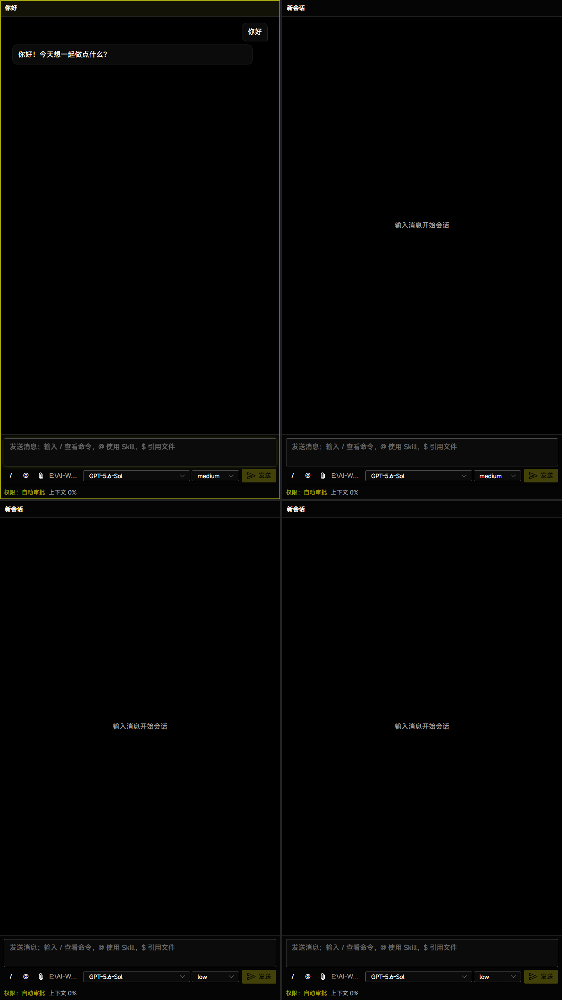
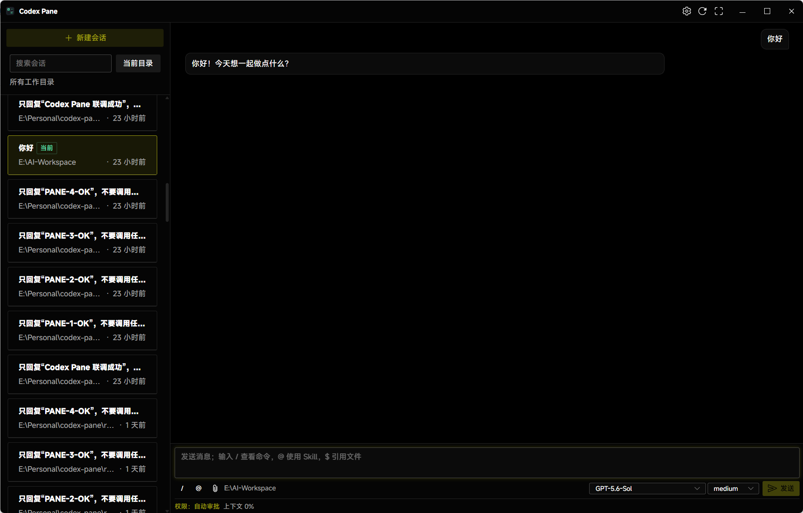
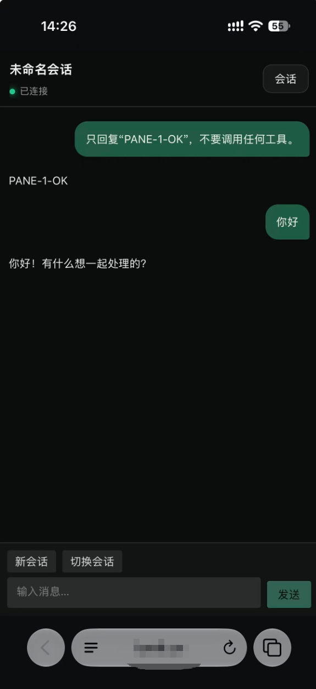

# Codex Pane

English | [简体中文](README.zh-CN.md)

Codex Pane is a Windows 11 desktop workbench built on Codex app-server. The desktop app offers multi-pane and session-sidebar layouts, while the optional self-hosted relay lets you continue conversations securely from a mobile browser.

## Quick Start

1. Install Codex CLI and PowerShell 7, and make sure `codex` works in PowerShell. Complete sign-in or configure your model provider before use.
2. Extract the Windows build into a writable directory and open `win-unpacked`. For source builds, see [Development](#development).
3. Run `Codex Pane.exe` and choose a default working directory.

## Screenshots

### Multi-Pane

Run several independent conversations in one window. Each pane has its own conversation, working directory, model, reasoning effort, and permission state.



### Session Sidebar

Focus on the current conversation while browsing, searching, and switching history from the sidebar. Switch desktop layouts at any time in Settings.



### Mobile Remote Access

Continue desktop conversations in a mobile browser.



## Features

- Create, resume, rename, search, and switch conversations.
- View replies, commands, diffs, tool calls, approvals, images, subagents, and background tasks.
- Set a global or per-pane working directory, and switch models, reasoning effort, and permission modes from the composer.
- Use `/` for commands, `@` for Skills, and `$` for workspace files.
- Attach local files and images or paste images directly.
- Use `F11` to enter or leave full screen; `Esc` and the top-right action also exit full screen.

## Remote Access

Remote access is optional and disabled by default. To enable it:

1. Deploy the relay by following the [remote deployment guide](remote/README.md).
2. Open Settings → Remote Access, enter the full HTTPS relay URL including any path prefix, enable remote access, and save.
3. Generate a pairing QR code and scan it with your phone.
4. Create the Passkey on the phone, verify the matching six-digit code, and confirm the phone on the desktop.

The mobile client can view, create, and switch conversations, send text messages, and provide one-time confirmation for eligible command or MCP operations. Models, permissions, working directories, file approvals, credentials, and other high-risk controls remain desktop-only.

Keep the desktop app running and the computer awake and online. Messages are end-to-end encrypted; the relay still sees connection metadata and serves the web bootstrap. See the [remote guide](remote/README.md) for deployment requirements and the trust boundary.

## Built-in Commands

`/agents` · `/cd` · `/compact` · `/fast` · `/goal` · `/mcp` · `/new` · `/permissions` · `/plan` · `/ps` · `/rename` · `/resume` · `/review` · `/skills` · `/status` · `/stop`

## Data Location

Application data defaults to `data/` beside the executable, or `data/` in the project directory during development. If that location is not writable, Codex Pane uses `%APPDATA%/codex-pane` and displays a warning. Set `CODEX_PANE_USER_DATA_DIR` before launch to choose another directory. Close the app before backing up its data and preserve it when upgrading.

Codex configuration, authentication, and conversation history remain in Codex's own home directory, selected by `CODEX_HOME` or the default user `.codex` directory. Back up that directory separately when needed.

## Development

Requires Node.js 24 or later.

```powershell
npm install
npm --prefix remote/mobile install
npm run dev
```

Validate the desktop, including end-to-end tests, and package it:

```powershell
npm run verify:desktop
npm run package:win
```

`package:win` creates the unpacked Windows application in `release/win-unpacked`. See [`remote`](remote) for relay and mobile development and deployment.

## License

[MIT](LICENSE)
