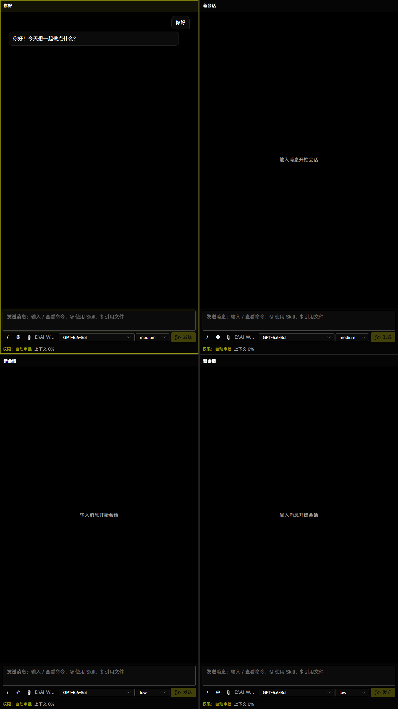
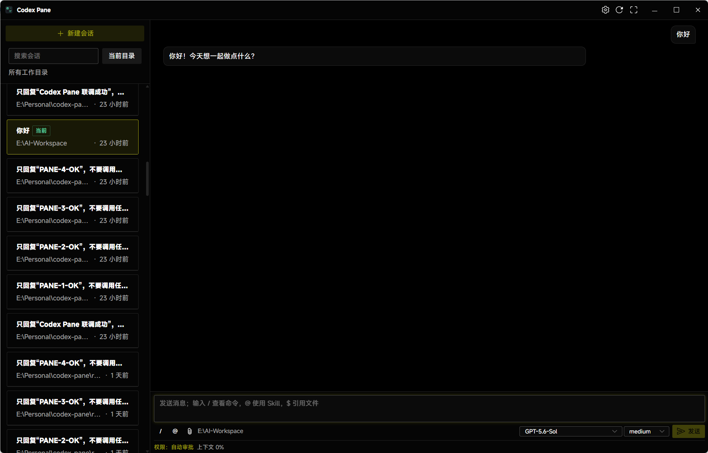
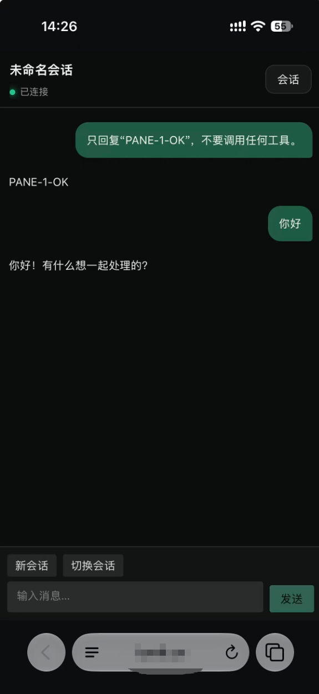

# Codex Pane

[English](README.md) | 简体中文

Codex Pane 是基于 Codex app-server 的 Windows 11 本机工作台。桌面端提供多窗格和会话侧栏两种布局，也可以通过自托管中转服务在手机浏览器中安全地继续会话。

## 快速开始

1. 安装 Codex CLI 和 PowerShell 7，确认 PowerShell 中可以运行 `codex`，并先完成登录或模型供应商配置。
2. 将 Windows 程序包解压到可写目录，打开 `win-unpacked`。从源码构建请参阅[开发](#开发)。
3. 运行 `Codex Pane.exe`，选择默认工作目录。

## 效果图

### 多窗格模式

在一个窗口中并行使用多个独立会话。每个窗格拥有自己的会话、工作目录、模型、推理强度和权限状态。



### 会话侧栏模式

专注当前会话，通过侧栏浏览、搜索和切换历史会话。两种桌面布局可随时在设置中切换。



### 手机远程访问

在手机浏览器中继续桌面会话。



## 主要功能

- 新建、恢复、重命名、搜索和切换会话。
- 查看回复、命令、差异、工具调用、审批、图片、子代理和后台任务。
- 为全局或单个窗格设置工作目录，并在输入区切换模型、推理强度和权限模式。
- 使用 `/` 选择命令，`@` 使用 Skill，`$` 引用工作区文件。
- 添加本地文件和图片，或直接粘贴图片。
- 使用 `F11` 进入或退出全屏；全屏时也可按 `Esc` 或点击右上角按钮退出。

## 远程访问

远程访问默认关闭。启用步骤：

1. 按照[远程端部署说明](remote/README.zh-CN.md)部署中转服务。
2. 打开“设置 → 远程访问”，填写包含路径前缀的完整 HTTPS 地址，启用并保存。
3. 生成配对二维码并使用手机扫码。
4. 在手机上创建 Passkey，核对两端的 6 位确认码，然后在桌面确认手机。

手机端用于查看、新建和切换会话、发送文字消息，以及对符合条件的命令或 MCP 操作做一次性确认。模型、权限、工作目录、文件审批、凭据和其他高风险控制只能在桌面端操作。

远程使用时需保持桌面应用运行、电脑唤醒且联网。消息采用端到端加密，中转仍能看到连接元数据并提供网页引导代码；部署要求和信任边界见[远程端说明](remote/README.zh-CN.md)。

## 内置命令

`/agents` · `/cd` · `/compact` · `/fast` · `/goal` · `/mcp` · `/new` · `/permissions` · `/plan` · `/ps` · `/rename` · `/resume` · `/review` · `/skills` · `/status` · `/stop`

## 数据位置

应用数据默认保存在可执行文件旁的 `data/` 目录中，开发模式使用项目目录下的 `data/`。该位置不可写时，会回退到 `%APPDATA%/codex-pane` 并显示提示。也可在启动前设置 `CODEX_PANE_USER_DATA_DIR` 指定其他目录。备份前先关闭应用，升级时保留数据。

Codex 配置、认证和会话历史仍位于 Codex 自己的数据目录，由 `CODEX_HOME` 指定，未设置时使用用户的 `.codex` 目录；需要时应另行备份。

## 开发

需要 Node.js 24 或更高版本。

```powershell
npm install
npm --prefix remote/mobile install
npm run dev
```

校验桌面功能（含端到端测试）并打包：

```powershell
npm run verify:desktop
npm run package:win
```

`package:win` 在 `release/win-unpacked` 中生成免安装 Windows 程序。中转服务和手机端的开发及部署说明见 [`remote`](remote)。

## 许可证

[MIT](LICENSE)
